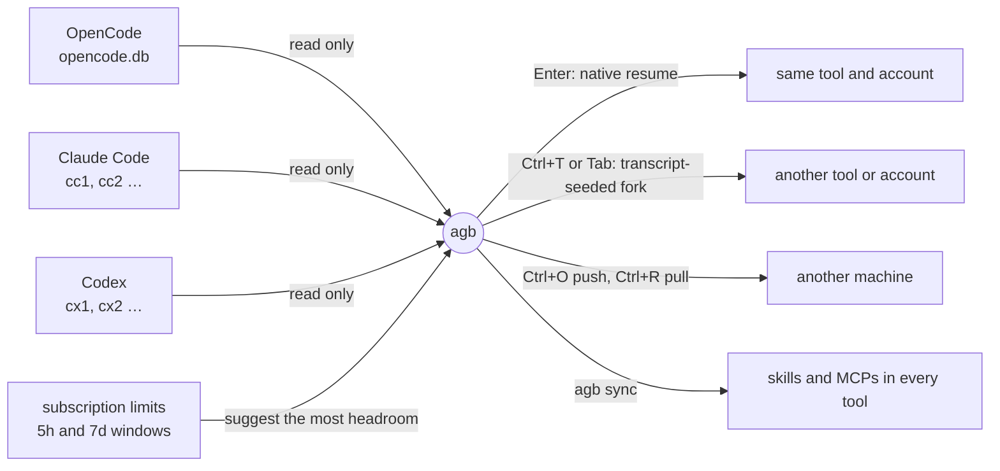

<p align="center">
  
</p>

<h1 align="center">AgentBridge</h1>

<p align="center">
  <b>Every coding-agent session you have, in one list.</b><br>
  Search OpenCode, Claude Code and Codex across all your accounts, open any session in
  whichever one has headroom left, carry it between machines, and keep skills and MCPs in sync.
</p>

<p align="center">
  <a href="https://github.com/sergio-gimenez/agent-bridge/actions/workflows/ci.yml"></a>
  <a href="LICENSE"></a>
  
  
  <a href="https://agentbridge.sergiogimenez.com/"></a>
</p>

<p align="center">
  <a href="#install">Install</a> ·
  <a href="#try-it-on-demo-data">Try the demo</a> ·
  <a href="docs/demos.md">All demos</a> ·
  <a href="https://agentbridge.sergiogimenez.com/">Documentation</a> ·
  <a href="CHANGELOG.md">Changelog</a>
</p>

<p align="center">
  
</p>

<p align="center"><sub>Recorded against invented sessions and limits; nothing in it is real. See <a href="demo/README.md">demo/</a>.</sub></p>

## Why

Your work is spread across three tools and however many accounts you signed
into. Finding the session where you actually solved something means
remembering which tool you were in, `cd`-ing to the right repo, then paging
through a separate resume list for every tool and every account. And when one
subscription runs dry halfway through a task, the conversation is stuck in it.

AgentBridge (`agb`) reads those stores directly, never writing to them, and
puts everything in one list, newest first, searchable by the words you typed
rather than only the title a tool gave it. From there a session goes wherever
you need it next.



## What it does

- **One list for every tool and account.** OpenCode, any number of Claude Code
  and Codex accounts, and OpenCode wrappers with their own stores. Rows start
  with where the session lives (`OC`, `CC1`, `CX2`), and the card beside the
  list shows your latest prompts and the assistant's replies.
- **Search what you asked.** Typing filters on titles, directories and your own
  prompts (assistant replies too with `--assistant`), and the matches light up
  in the card.
- **Open it where there is headroom.** The header suggests the account with the
  most capacity left across its 5h and 7d windows. `Ctrl+T` lists every account
  with its limit bars and opens the selection in the one you pick.
- **Fork, natively or across tools.** `Ctrl+F` branches inside the same tool
  with its own fork command. Across tools or accounts, `agb` seeds a new session
  with the transcript and saves the full history for the agent to read.
  [Forks and handoffs](docs/forking.md).
- **Start fresh anywhere.** `Ctrl+N` starts a blank conversation in any project
  you have worked in, with any account, from the same limits view.
- **Hand a session to another machine.** `Ctrl+O` pushes it to an always-on box
  before you leave, and `Ctrl+R` pulls it back as the same session, not a copy.
  [Push and pull](docs/push-pull.md).
- **Share skills and MCPs.** Define them once in a profile and `agb sync` writes
  each tool's own config for every account. [Shared setup](docs/setup.md).
- **Works with Herdr.** A plugin opens the picker in a tab, and `agb herdr
  install` brings conversations back in their own accounts after a restart.
  [Herdr guide](docs/herdr.md).
- **One static binary, fast.** No runtime to install; a cache means the picker
  opens in a few tens of milliseconds even with hundreds of sessions.

## Install

Needs Go 1.23+ to build, and at least one of OpenCode, Claude Code and Codex.
The result is a single static binary.

```bash
git clone https://github.com/sergio-gimenez/agent-bridge.git
cd agent-bridge
make install              # puts `agb` in ~/.local/bin, no root needed
agb
```

`agb` finds each tool's default store on its own. To add a second Claude or
Codex account, see [multiple Claude Code accounts](docs/multiple-claude-accounts.md)
and [multiple Codex accounts](docs/multiple-codex-accounts.md).

Coming from `opencode-sessions` or `ocs`? Configuration and cache now live in
`~/.config/agentbridge` and `~/.cache/agentbridge`, and environment overrides
use `AGB_*`. Move any existing configuration or cache there before removing the
older installation; `make install` removes the obsolete command aliases.

## Try it on demo data

```bash
make demo
```

That builds a synthetic history (two Claude accounts, two Codex accounts, an
OpenCode store, four invented projects, made-up subscription limits) and runs
the real picker against it with opening stubbed out. A second fake machine,
"desk", is there to try `Ctrl+O` (push) and `Ctrl+R` (browse and pull) on.
Nothing of yours is read and nothing gets launched. Details in
[`demo/README.md`](demo/README.md).

## Keys

| Key | What it does |
| --- | --- |
| type | Filter by title, directory and your prompts |
| `↑` `↓` | Move the selection |
| `PgUp` `PgDn` `Home` `End` | Jump |
| `Enter` | Follow the displayed route |
| `Ctrl+F` | Fork: follow the same route, but branch into a new session |
| `Ctrl+T` | Choose where to open the selection, from every account and its limits; `Enter` resumes there, `Ctrl+F` forks there |
| `Ctrl+N` | Start a new conversation: choose an agent/account and project directory |
| `Ctrl+E` or right-click | Open the selected conversation's action menu |
| `Shift+Tab` | Cycle the pinned target backwards: OpenCode ← each Claude account ← each Codex account |
| `Tab` | Open in the *next tool* right away, as a transcript-seeded fork |
| `Ctrl+G` | Pin the suggested subscription as the target |
| `Ctrl+Y` | Toggle yolo: bypass permission checks for this launch only |
| `Ctrl+O` | Push the session to another machine ([push and pull](docs/push-pull.md)) |
| `Ctrl+R` | Browse another machine's sessions; `Enter` there pulls one and resumes it here |
| `Ctrl+←` `Ctrl+→` | Move the divider between the list and the card; the width is remembered |
| `F1`, or `?` with an empty search | The built-in guide |
| `Esc` `Ctrl+C` | Cancel |

The mouse works too: click a conversation to select it, double-click to follow
the displayed `Enter` action, and scroll the list with the wheel. Right-click
a conversation for its full action menu. Every visible footer action is
clickable, including push, browse, target and YOLO, and so are the push
panel's controls. Hold Shift while dragging to select terminal text in
terminals that support it.

## Reading the list

Each row is one session: where it lives, its title, its project and how long
ago it was last touched. The card on the right shows the selected session's
directory, account, id and limits, then your latest prompts and the
assistant's latest replies, with your search terms highlighted.

| Row starts with | Meaning |
| --- | --- |
| `OC` | An OpenCode session, resumed natively. |
| `CC1` | A Claude session owned by account `cc1`, resumed natively. |
| `CX1` | A Codex session owned by account `cx1`, resumed natively. |
| `CC1 →` | Enter carries it to the pinned target (shown in the header) as a seeded fork. The arrow takes the target tool's colour. |

Until you press `Shift+Tab` or `Ctrl+G` the target follows the selection, so
rows show no arrow and `Enter` resumes whatever you picked in the account it
already belongs to. `Ctrl+T` asks instead: it lists every account with its
limit bars, as `Ctrl+N` does, and opens the selection in the one you choose.
Pinning a destination changes the header to `target CX2`, crossing rows get
an arrow, and the card spells out where `Enter` will open the session. The
footer always says what `Enter` and `Tab` will do, and a red `YOLO` in the
header means the launch will skip permission checks.

The suggestion in the header is advice only: `Enter` still resumes a session
in its own account unless you pin another target. How the limits are read and
cached is in [configuration and internals](docs/reference.md#subscription-suggestions).

On macOS `Ctrl+←` and `Ctrl+→` switch Spaces by default; free them under
System Settings → Keyboard → Keyboard Shortcuts → Mission Control if you want
them in the terminal. Below 90 columns the card is hidden and the list takes
the whole width.

## Starting a new conversation


Click `^n new` in the footer or press `Ctrl+N`. Pick the directory from the
projects you already have sessions in (`↑`/`↓` or a click, newest first), type to
filter them, or type a path such as `~/src/` to list its subdirectories
(`Ctrl+U` clears it). Below, every account has a bar per limit window (5h, 7d),
when the tightest one resets, and which one is suggested. Choose the agent and
account with `Tab`, `Ctrl+T`, `←`/`→` or a click, or `Ctrl+G` for the suggested
one, then press `Enter` or click `enter start`. `Ctrl+Y` toggles YOLO for this
launch. The directory defaults to where you ran `agb`, and the right-click menu
also offers a new conversation in the selected conversation's project.

From the command line:

```sh
agb new --target cx1 --dir ~/my-project
```

Without `--target`, `agb new` opens the chooser. Without `--dir`, it uses your
current directory. New conversations start with a blank interactive agent;
they don't resume a session or carry over a transcript, so this works before
you have any saved conversations.

## Forks and handoffs

`Enter` continues the picked session, so new turns land in the original
conversation. `Ctrl+F` follows the same route but branches, and the original
stays exactly as you left it. Inside one tool and account the fork is native
(`claude --resume <id> --fork-session`, `codex fork <id>`), so it carries the
real session state.

Session ids are not portable between tools or between accounts, so opening a
session elsewhere is a fork, never a move: `agb` starts a new session in the
target, seeds it with the transcript, and saves an untruncated copy in
`~/.cache/agentbridge/handoffs/` for the agent to read. The original stays
where it was. Do it at a boundary that makes sense, such as a finished task,
rather than ping-ponging between tools.
**[What a handoff carries](docs/forking.md)**.

## Pushing and pulling a session between machines


A Claude Code or Codex session lives on one machine at a time. `Ctrl+O` in the
picker (or `agb push desk ID`) hands it to another of your machines, and
`Ctrl+R` (or `agb pull desk ID`) browses that machine and brings one back. On
the other side it resumes as the same session, not as a seeded fork.

```
 laptop                                   desk
┌────────────┐   push  Ctrl+O  ───────►  ┌────────────┐
│ your list  │                           │ herdr tab  │──► phone
│            │   ◄───  Ctrl+R ↵  pull    │            │
└────────────┘                           └────────────┘
 stops only if it is open on either side, or the other copy is bigger
```

Neither is a sync. The copy being sent replaces the other one. Code travels
through git, so a dirty checkout gets a note, never a stop. An `arrive` hook per
host can start the session once it lands, for example in a
[herdr](https://herdr.dev) tab where your phone can follow it.
Setup, the checks, what travels, and troubleshooting:
**[docs/push-pull.md](docs/push-pull.md)**.

## Sharing skills and MCPs

Define a capability once and let `agb` write it into every tool and account's
own configuration:

```bash
agb setup --example     # a starter profile to merge into your config
agb plan                # what would change, per target
agb sync                # apply it
agb sync --check        # exit 1 when something has drifted
```

Skills are linked rather than copied, so updating the source updates every
tool. An entry you wrote by hand under the same name with a different
definition is reported as a conflict, not overwritten.
**[Share skills and MCPs](docs/setup.md)**, and the
[design behind it](docs/shared-agent-setup.md).

For memory files and diagram servers that every tool can share, see
[memory and diagrams across tools](docs/integrations.md).

## Herdr

Using the `sergio.agb` Herdr plugin? Open the picker with `Ctrl+B`, then `A`.
For a remote session, connect with
`herdr --remote desk --remote-keybindings server` so Herdr enables the remote
plugin's shortcut.

Run `agb herdr install` once on each machine that runs your agents to restore
Claude and Codex conversations in their original accounts after a Herdr restart.
See [Switching agents in Herdr](docs/herdr.md) for the full workflow, including
[account-aware restore](docs/herdr.md#restore-conversations-after-a-restart),
YOLO mode and troubleshooting.

## Command line

Press `F1` in the picker or any of its dialogs for the built-in guide, or run
`agb help` to read it, with the command reference, in your shell.

| Flag | Effect |
| --- | --- |
| `--print` | List the 25 most recent sessions and exit, no picker |
| `--query <text>` | Start the picker with a filter already applied |
| `--assistant` | Search assistant replies too, not just your prompts |
| `--target <name>` | Start with this target: `oc`, or any configured account name |
| `--claude-account <name>` | Same, named for Claude accounts |
| `--codex-account <name>` | Same, named for Codex accounts |
| `--dangerous`, `--skip-permissions`, `--yolo` | Bypass permission checks ([permissions](docs/reference.md#permissions)) |
| `--safe`, `--no-skip-permissions` | Force permission checks on |
| `--rescan` | Ignore the session cache and rebuild it |
| `--print --json` | List sessions as JSON, with whether each is open (what `Ctrl+R` reads from another machine) |
| `--help`, `-h` | Usage |

| Command | Effect |
| --- | --- |
| `agb new [--target NAME] [--dir DIR]` | Start a blank conversation, or open its chooser |
| `agb open ID` | Open a session by id, without the picker |
| `agb push HOST ID` | Push a session to another machine ([push and pull](docs/push-pull.md)) |
| `agb push ID` | The same, asking for the host and directory |
| `agb pull HOST ID` | Pull a session from another machine |
| `agb limits` | Show subscription headroom and the suggested target |
| `agb limits --json` | Stable target/limit report for launchers and integrations |
| `agb limits --refresh` | Bypass the two-minute usage cache |
| `agb herdr install [--target NAME] [--dry-run]` | Set up account-aware conversation restore in Herdr ([guide](docs/herdr.md#restore-conversations-after-a-restart)) |
| `agb herdr uninstall [--target NAME] [--dry-run]` | Remove agb's restore hooks; keep other hooks |
| `agb setup`, `agb plan`, `agb sync` | Shared skills and MCPs ([setup](docs/setup.md)) |
| `agb help` | The guide and command reference |

`AGB_DRY_RUN=1 agb` prints what it would launch instead of launching it. Account
configuration, permission defaults, where every piece of data comes from and
why the picker starts fast are in
**[configuration and internals](docs/reference.md)**.

## Development

```bash
go run ./cmd/agb            # run the picker from source
go run ./cmd/agb --print    # list recent sessions, no TUI
make demo                   # picker against synthetic sessions, opening stubbed out
make demo-record DEMO=push  # re-record a demo (DEMO= empty, push, pull or actions), then make demo-gif
make docs-serve             # preview the documentation site
make vet test build
```

See [CONTRIBUTING.md](CONTRIBUTING.md).

## License

[MIT](LICENSE) © Sergio Gimenez
