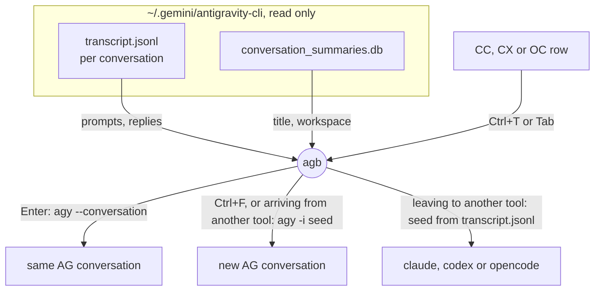

# Antigravity CLI (`agy`)

The Antigravity CLI is Google's terminal coding agent. Google shipped it at
I/O in May 2026, alongside the Antigravity 2.0 desktop app, and it takes over
from Gemini CLI. The binary is called `agy`. It runs the Gemini 4 family (Neon,
Carbon, Hydrogen, Argon) and, depending on your plan, a few Claude and open
models too.

In `agb` its conversations show up as <span class="agb-label agb-label--ag">AG</span>
rows next to everything else. The useful trick is the other direction: take a
Claude or Codex conversation that's run out of quota, press `Ctrl+T`, pick
`AG`, and carry on with Gemini 4 with the whole transcript in hand.



## Install and sign in

```bash
curl -fsSL https://antigravity.google/cli/install.sh | bash
agy --version
```

The installer is worth a read (it's about 240 lines of Bash): it fetches a
manifest from Google's update server, checks the SHA-512 of the download, copies
`agy` to `~/.local/bin` and runs `agy install` to set up your shell. After
that `agy` updates itself in the background. Other install routes are on
[Google's getting-started page](https://antigravity.google/docs/getting-started?tab=cli).

Then run it once, in a project you trust:

```bash
cd ~/src/my-project
agy
```

It walks you through signing in with your Google account in the browser and
asks whether to trust the folder. The sign-in is kept in the system keyring rather
than in a file under your home. Leave the TUI with `/quit` or `Ctrl+D` twice.

Send it a prompt and wait for the reply. That one exchange matters: `agy`
creates its store on first use, and `agb` only adds the `AG` target once that
store exists.

## Choose a model

Inside `agy`, `/model` switches model and `/effort` the reasoning level. The
choice sticks in `~/.gemini/antigravity-cli/settings.json`, so every
conversation `agb` launches later uses it too. `agb` deliberately doesn't pass
a model of its own.

To see what your account can use:

```bash
agy models
```

When this page was written, in late November 2026, it printed the four
Gemini 4 models at several effort levels (from `gemini-4-neon-low` up to
`gemini-4-hydrogen-xhigh`), three "Orchestrator" variants, Gemini 3.8 Flash,
Claude Opus and Sonnet 5.5, and GPT-OSS 120B. Google changes this list often,
so trust `agy models` over this paragraph.

## Using it from agb

Nothing to configure. Once `agy` has run, `agb` lists its conversations and
`ag` joins the targets:

| You do | `agb` runs |
| --- | --- |
| `Enter` on an <span class="agb-label agb-label--ag">AG</span> row | `agy --conversation <id>`, in the conversation's workspace |
| `Ctrl+F` on an AG row | `agy -i "<transcript seed>"`: a new conversation, since `agy` has no fork flag |
| `Ctrl+T` → AG, or `Tab` from a Codex row | `agy -i "<transcript seed>"` |
| `Ctrl+N` with target AG | `agy` |
| Any of those with `Ctrl+Y` (YOLO) | the same, plus `--dangerously-skip-permissions` |
| `Ctrl+T` → CC, CX or OC on an AG row | that tool, seeded from the AG transcript |

`agy -i` sends the seed as the first turn and then stays interactive, which is
the behaviour you want; `-p` would print one answer and quit.

Check a route without launching anything:

```console
$ AGB_DRY_RUN=1 agb open eac18b4c --fork
would run agy -i <transcript seed, 1247 chars>
  in ~/mystuff/SideProjects/agent-bridge
```

### Titles and search

`agy` writes a short title for each conversation into its summaries index, a
moment after the first reply, and `agb` uses it. A conversation started with
`agy -p` gets no title, so its row is titled by the opening prompt, the same
fallback Codex rows use. Search matches what you typed, not the metadata `agy`
wraps around it (local time, settings changes), and skips tool calls and their
output.

## Configuration

The `AG` target turns up on its own on any machine where `agy` has run. Two
settings in `~/.config/agentbridge/config.json` change that:

```json
{ "antigravity": { "skipPermissions": true } }
```

launches `agy` with `--dangerously-skip-permissions` by default (`Ctrl+Y` and
`--safe` still override it), and

```json
{ "antigravity": false }
```

hides Antigravity completely, even with `agy` installed.

## What agb reads

`agb` never writes to the `agy` store. Of everything under
`~/.gemini/antigravity-cli`, it opens two things:

```text
~/.gemini/antigravity-cli/
├── brain/<conversation-id>/.system_generated/logs/
│   └── transcript.jsonl        one JSON step per line: prompts, replies,
│                               tool calls, tool output
├── conversation_summaries.db   SQLite: title, workspace_uris, last modified
├── conversations/<id>.db       protobuf blobs (not read)
└── settings.json               your model choice (not read)
```

From `transcript.jsonl` it keeps `USER_INPUT` steps from you (the text inside
`<USER_REQUEST>`) and `PLANNER_RESPONSE` steps that carry text. The workspace
comes from the first `file://` URI in `workspace_uris`. Parsed transcripts go
into `agb`'s cache like every other tool's, so only conversations that changed
get read again.

## What doesn't work yet

**One account.** `agy` keeps credentials in the keyring and has no variable
like `CLAUDE_CONFIG_DIR` or `CODEX_HOME` to point it at a second home, so there's
no clean way to run two Google accounts side by side. `agb` supports exactly one
`AG` account.

**Limits show `unknown`.** `agy` reports quota only through `/usage` inside
its TUI. There's no command or file `agb` can read, so `AG`
never gets bars and is never the suggested target.

**No push, pull or Herdr restore.** A conversation is spread over several
files plus a shared index, and moving one to another machine safely is its own
project.

**`agb sync` refuses `ag` as a target.** `agy` reads MCP servers from its own
file, `~/.gemini/config/mcp_config.json`, and skills from `skills/` folders
under its customization roots such as `.agents/skills`. `agb` doesn't write
that file yet, so putting `ag` in a setup profile fails with a clear error
rather than half-applying the profile.

**Antigravity IDE conversations aren't listed.** The desktop app indexes its
conversations in the same summaries database, but stores them as opaque `.pb`
files with no plaintext transcript. `agy`'s own `/resume` picker can open them
from its "Other" tab.

## Troubleshooting

**No `AG` rows and no `ag` target.** `agy` hasn't created
`~/.gemini/antigravity-cli` yet; run it once and send a prompt. If the folder
exists, check that your config doesn't say `"antigravity": false`.

**`agy not found on PATH`.** The installer uses `~/.local/bin`. Add it to `PATH`
in the shell `agb` runs from.

**A row says `unknown` for its directory.** The summaries index had no
workspace for it yet, usually because `agy` was still writing it. `Enter`
refuses to resume without a directory, but `Ctrl+F` works: the seeded fork
starts in the directory you ran `agb` from. `agb` reads the index fresh on
every run, so once `agy` has written the workspace, the next `agb` shows it.

**A conversation is missing.** `agb` skips conversations with no prompt yet,
and anything from the Antigravity IDE (see above). `agb --print --rescan`
rebuilds the cache if you suspect it's stale.
