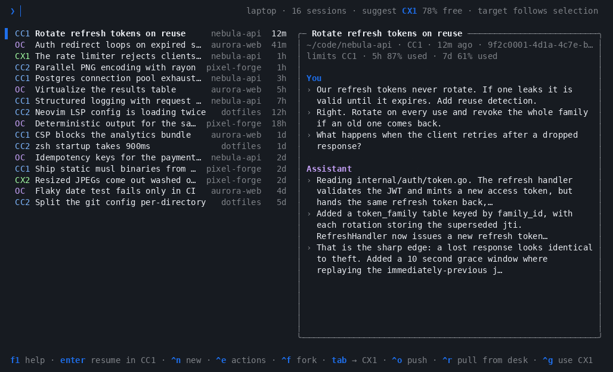

# Demos

Every recording in one place. They all run the real picker against synthetic
sessions (see [`demo/`](../demo/README.md)), so nothing in them is anyone's
actual history. Each GIF is rendered from the asciinema recording linked under
it; `asciinema play <file>.cast` replays one in your terminal.

## The picker


One list across OpenCode, Claude Code and Codex, filtered by a word from your
prompts. `Ctrl+T` then shows every account's limits, and the Claude session,
whose account is nearly out of its 5h window, opens in the suggested Codex
account as a transcript-seeded fork.
Recording: [`demo.cast`](demo.cast) · More: [AgentBridge](../README.md)

## Right-click actions and new conversations


A conversation's right-click menu, a new conversation in the same project, the
account switched to Codex from the footer, and a blank launch.
Recording: [`actions.cast`](actions.cast) · More: [Switching agents in Herdr](herdr.md)

## Push a session to another machine


`Ctrl+O` turns the card into a push panel, checks both sides and hands the
session to desk.
Recording: [`push.cast`](push.cast) · More: [Push and pull](push-pull.md)

## Pull a session back



`Ctrl+R` browses desk's sessions; one still open there cannot be pulled.
Recording: [`pull.cast`](pull.cast) · More: [Push and pull](push-pull.md)

## Recording a new one

```bash
make demo-record DEMO=<name>   # docs/<name>.cast
make demo-gif DEMO=<name>      # docs/<name>.gif
```

Add the GIF to this page. The docs build fails while a GIF or cast in `docs/`
is not linked from any page.
