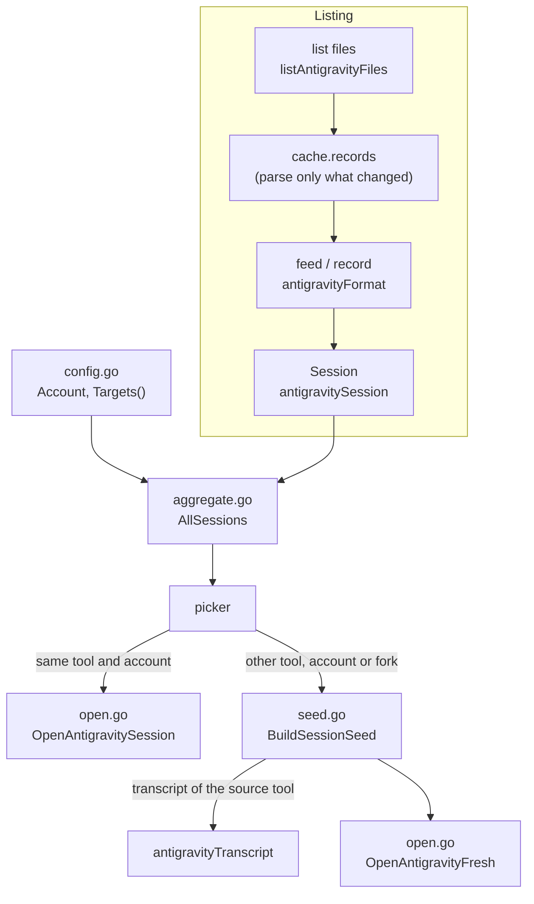

# Adding an agent

Antigravity was the fourth agent `agb` learned, in November 2026. It took one
new Go file and small changes to ten others, help text included, and most of
the effort went into reading `agy`'s files on disk rather than writing code.
This page is that work written down, so the fifth agent goes faster.

## Does the agent qualify?

Before writing code, run the agent once and look at what it leaves behind. It
needs three things, and they're worth checking by hand:

1. **A session store you can read without the agent running.** JSONL or SQLite
   is ideal. Encrypted or protobuf-only stores are a dead end: the Antigravity
   *IDE* writes `.pb` files with no readable structure, which is why its
   conversations aren't listed, while the CLI also writes a plaintext
   `transcript.jsonl` per conversation.
2. **Resume by id**, as a flag (`agy --conversation <id>`) or a subcommand
   (`codex resume <id>`).
3. **Start with a prompt and stay interactive** (`agy -i "<prompt>"`), because
   that's how every cross-tool fork arrives. A flag that answers once and exits,
   like `agy -p`, doesn't count.

Nice to have, each unlocking one more feature:

| If the agent has | You get |
| --- | --- |
| a native fork flag | `Ctrl+F` without a seeded copy |
| a variable that moves its home (`CODEX_HOME`) | several accounts |
| a readable usage or quota interface | limit bars and suggestions |
| sessions that are a single file | push and pull, later |

The cheapest way to learn the format is to diff the filesystem around a first
run: `touch` a marker file, use the agent, then
`find ~ -newer marker -type f`. That's how `agy`'s store turned up, under
`~/.gemini/antigravity-cli/`, which none of the write-ups about `agy` described.

## How a tool plugs in



Everything lives in `internal/ocs`. A new agent gets its own file (Antigravity's
is `antigravity.go`, about 300 lines with comments) and short additions
elsewhere.

## The changes, file by file

**`types.go`.** Add the `Source` constant. Its string value ends up in
`--print --json` output and in the cache, so pick it once and keep it:
`SourceAntigravity Source = "antigravity"`.

**Your reader (`antigravity.go`).** Four pieces:

- A `transcriptFormat`: `feed(state, line)` consumes one line and appends to
  `state.User` or `state.Assistant`; `record(state)` returns `nil` for a
  session with no prompt. The cache stores the parse state and resumes from the
  last offset when a file grows, so `feed` must not depend on seeing the file
  from the start in one go.
- A file lister that returns `scannedFile`s (path, size, mtime, inode), which is
  what the cache keys on.
- A function that turns a record into a `Session`: id, title, directory, the
  last few prompts and replies, and `SearchText`. Put the replies into
  `SearchText` only when `scope == ScopeAll`.
- A transcript reader for handoffs that keeps formatting intact. The listing
  collapses whitespace; a seed shouldn't.

Strip whatever the agent injects into user turns. Codex prepends `AGENTS.md`
and environment blocks; `agy` wraps your text in `<USER_REQUEST>` and appends
the local time and settings changes. If you leave those in, they become titles
and match searches.

If titles or directories live outside the transcript (for `agy`, in
`conversation_summaries.db`), read that index once per listing and join on id.
Open SQLite read-only with `mode=ro&_pragma=query_only(1)`, and check the file
exists first, or the driver will happily create an empty database.

**`aggregate.go`.** Dispatch the new tool in `AllSessions`.

**`config.go`.** Decide how accounts are configured. Antigravity has one, so
it's a single optional `*Account` that `LoadConfig` enables when the store
exists; tools with a home variable follow the `codexAccounts` pattern
instead. Add it to `Targets()`. Keep `ParseConfig` free of filesystem checks;
tests depend on that.

**`targets.go`.** The fallback label (`AG`), `ToolName`, and the tool's place in
`toolOrder`, which decides where `Tab` goes.

**`render.go`.** A colour in `sourceColor`. The four in use are blue, green,
magenta and yellow.

**`open.go`.** Native resume in `OpenWith`, the seeded start
(`OpenAntigravityFresh`), and the blank start in `OpenNew`. If the agent has no
fork flag, route `Fork` through the seeded path, as OpenCode 2 and Antigravity
do. Add the permission-bypass flag for YOLO.

**`seed.go`.** One line in `BuildSessionSeed` pointing at your transcript
reader, so sessions can leave the new tool as well as arrive in it.

## Things to fence off

Some subsystems switch on the tool and quietly do the wrong thing for one they
don't know. For each, decide whether to implement it or refuse it loudly:

- **Usage.** No entry in `usageProbes` means `unknown`, which is correct.
- **Push and pull, Herdr.** Gated to Claude Code and Codex by explicit checks;
  nothing to do.
- **`agb sync`.** `setupDestination` must return an error for a tool it can't
  write, or a profile naming it produces an empty config path. Antigravity
  returns "agb sync does not manage Antigravity yet".

## Tests

Build fixtures from the agent's real output, not from what its docs claim:
copy a few lines of a real transcript, trim them, and keep the awkward cases
(a tool-only step, a step with no text, the injected metadata). The
Antigravity tests also build a summaries database with the real column names.

Cover at least:

- the reader keeps prompts and replies and drops everything else;
- the session joins the index, and falls back when the index or title is missing;
- each launch route, through `AGB_DRY_RUN` and the `dryRun` test helper;
- config: target present, absent and turned off.

Tests must not read your real home; point `Account.Home` at `t.TempDir()`, and
stub detection functions like `antigravityInstalled`. If you change what an
existing parser extracts, bump `cacheVersion` in `cache.go`.

Then try it for real:

```bash
go run ./cmd/agb --print --json | jq '.[] | select(.source == "antigravity")'
AGB_DRY_RUN=1 go run ./cmd/agb open <id> --fork
```

## Docs

A new agent needs a page under `docs/agents/`, a column in the table on the
[agents overview](../agents/index.md), a row in the
[install table](../getting-started/install.md), the label in
[using the picker](../getting-started/picker.md), its paths in
[configuration and internals](../reference.md#where-the-data-comes-from), the
built-in guide in `help.go`, and a `CHANGELOG.md` entry.

[CONTRIBUTING.md](https://github.com/sergio-gimenez/agent-bridge/blob/main/CONTRIBUTING.md)
has the rest: setup, `make vet test build`, and how CI runs.
