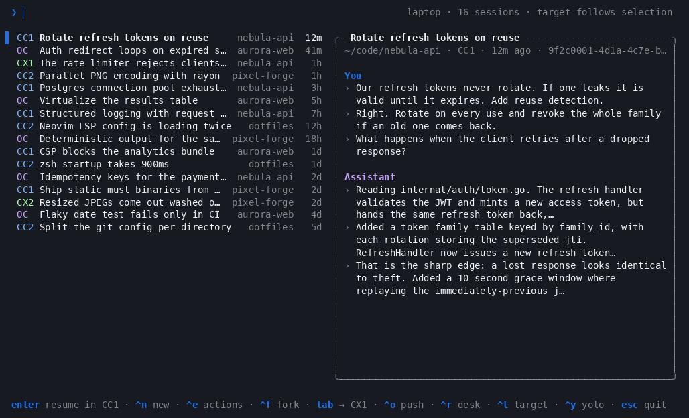

# Using the picker

Run `agb` and you get two panes: the list of sessions on the left, and a card
on the right for whichever one is selected. The card shows its directory,
account, id and that account's limits, then your latest prompts and the
assistant's latest replies with your search terms lit up.

Press `F1` anywhere (or `?` while the search box is empty) for the built-in
guide; it covers the same ground as this page and works offline.

## Reading the list

Each row starts with where the session lives, then its title, its project and
how long ago it was touched.

| Row starts with | Meaning |
| --- | --- |
| <span class="agb-label agb-label--cc">CC1</span> | A Claude Code session owned by account `cc1`. `Enter` resumes it there. |
| <span class="agb-label agb-label--cx">CX2</span> | A Codex session owned by account `cx2`. |
| <span class="agb-label agb-label--oc">OC</span> | An OpenCode session. Wrapper stores show their own name instead. |
| <span class="agb-label agb-label--ag">AG</span> | An Antigravity CLI (`agy`) conversation. |
| <span class="agb-label agb-label--cc">CC1 →</span> | `Enter` carries it to the pinned target in the header, as a seeded fork. The arrow takes the target tool's colour. |

Until you pin something, the target follows the selection: rows have no
arrows, and `Enter` resumes whatever you picked in the account that already
owns it. Pin a destination with `Shift+Tab` or `Ctrl+G` and the header changes
to `target CX2`, every row that would cross over grows an arrow, and the card
spells out exactly where `Enter` will open it.

The footer always says what `Enter` and `Tab` are about to do. A red `YOLO` in
the header means the next launch skips the agent's permission prompts.

## Keys

| Key | What it does |
| --- | --- |
| type | Filter by title, directory and your prompts |
| `↑` `↓` `PgUp` `PgDn` `Home` `End` | Move |
| `Enter` | Follow the route the row shows |
| `Ctrl+F` | Same route, but branch into a new session and leave the original alone |
| `Ctrl+T` | Pick where to open it from every account, with limit bars; `Enter` resumes there, `Ctrl+F` forks there |
| `Tab` | Open in the *next tool* right away, as a transcript-seeded fork |
| `Shift+Tab` | Cycle the pinned target backwards through every tool and account |
| `Ctrl+G` | Pin the suggested account (the one with the most headroom) |
| `Ctrl+N` | New conversation: choose an agent, an account and a project |
| `Ctrl+E` or right-click | The selected session's action menu |
| `Ctrl+Y` | Toggle YOLO for this launch only; nothing is saved |
| `Ctrl+O` | Push the session to another machine ([push and pull](../push-pull.md)) |
| `Ctrl+R` | Browse another machine's sessions and pull one |
| `Ctrl+←` `Ctrl+→` | Move the divider; the width is remembered |
| `F1` | The built-in guide |
| `Esc` `Ctrl+C` | Leave |

`Tab` skips the other accounts of the current tool on purpose, because "try
this in a different agent" is the common move and "walk all my Claude accounts"
isn't. The tool order is OpenCode, Claude Code, Codex, Antigravity, wrapping
around, so `Tab` on a Claude row opens it in Codex and on a Codex row in
Antigravity (when `agy` is set up).

The mouse works as well. Click to select, double-click to follow the `Enter`
route, scroll with the wheel, and right-click for the full action menu. Every
action in the footer is clickable, push panel buttons included. Hold Shift
while dragging if you want to select terminal text instead.

??? tip "macOS eats Ctrl+← and Ctrl+→"

    By default they switch Spaces. Free them under System Settings → Keyboard
    → Keyboard Shortcuts → Mission Control if you want them in the terminal.
    Below 90 columns the card hides itself and the list takes the full width
    anyway.

## Search

Words match in any order and without regard to case, so `flaky migration`
finds a session whose prompts say "the migration is flaky again". By default
only titles, directories and what *you* typed count, which keeps the noise of
long assistant replies out. Start with `agb --assistant` to search replies too,
or `agb --query "mesh vpn"` to open with a filter already in place.

## Start a new conversation



`Ctrl+N` (or `^n new` in the footer) opens a chooser. Pick a directory from the
projects you already have sessions in, newest first, or type a path such as
`~/src/` to browse its subdirectories; `Ctrl+U` clears it. Underneath, every
account shows a bar per limit window and when the tightest one resets. Choose
the agent and account with `Tab`, `←` `→` or a click (`Ctrl+G` takes the
suggested one), then `Enter`.

The same thing from a shell:

```bash
agb new --target cx1 --dir ~/my-project
agb new                       # opens the chooser in the current directory
```

New conversations are blank. They don't resume anything or carry over a
transcript, which also means they work before you've saved a single session.

`Ctrl+S` inside the chooser turns it into a
[secret conversation](../secret.md).

## Where there's headroom

The header suggests the account with the most capacity left, judged by the
tightest of its 5h and 7d windows. It's advice: `Enter` still resumes in the
session's own account unless you pin something else, and `Ctrl+G` is how you
take the suggestion. Claude Code and Codex report their limits; OpenCode and
Antigravity show as `unknown` because neither exposes a subscription limit `agb`
can read. The details of how limits are fetched and cached are in
[configuration and internals](../reference.md#subscription-suggestions).
