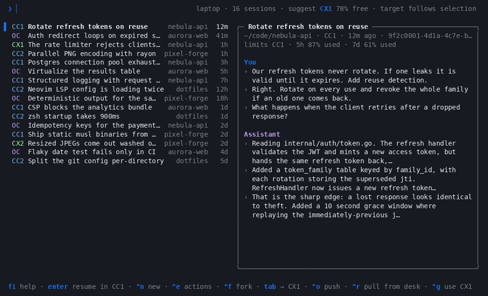
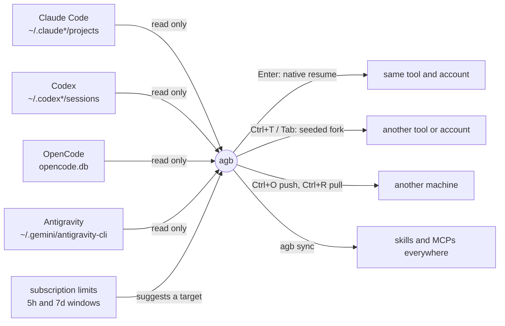

<div class="agb-hero" markdown>


# Every coding-agent session you have, in one list { .agb-hero__title }

<p class="agb-hero__lede">
Search Claude Code, Codex, OpenCode and Antigravity across all your accounts,
then open any conversation in whichever one still has quota left.
</p>

<div class="agb-chips" aria-label="Supported agents">
  <a class="agb-chip agb-chip--cc" href="agents/claude-code/">CC Claude Code</a>
  <a class="agb-chip agb-chip--cx" href="agents/codex/">CX Codex</a>
  <a class="agb-chip agb-chip--oc" href="agents/opencode/">OC OpenCode</a>
  <a class="agb-chip agb-chip--ag" href="agents/antigravity/">AG Antigravity</a>
</div>

```bash
curl -fsSL https://agentbridge.sergiogimenez.com/install.sh | sh
```

[Get started](getting-started/install.md){ .md-button .md-button--primary }
[Watch the demos](demos.md){ .md-button }

</div>

<figure class="agb-shot" markdown>

<figcaption>Recorded against invented sessions and limits. Nothing in it is anyone's real history.</figcaption>
</figure>

## Why it exists

Say you fixed a flaky migration last Thursday and want that conversation back.
Was it Claude Code or Codex? Which of your two Claude accounts, and which repo
were you `cd`'d into? Every tool keeps its own resume list, per account and per
directory, and none of them searches what you actually typed.

Or your Claude subscription hits its 5-hour limit halfway through a refactor,
and the conversation is stuck in an account you can't use until the window
resets.

`agb` reads every tool's session store directly (it never writes to them) and
puts the lot in one list, newest first. From there a conversation goes wherever
you need it next.

<div class="grid cards" markdown>

-   :lucide-search: **Search what you asked**

    ---

    Typing filters on your own prompts, titles and directories, so "migration
    flaky" finds the session even when the tool titled it "Fix tests".
    `--assistant` searches the replies too.

-   :lucide-gauge: **Open it where there's headroom**

    ---

    The header names the account with the most room left in its 5h and 7d
    windows. `Ctrl+T` shows every account's bars and opens the conversation in
    the one you pick.

-   :lucide-git-fork: **Fork across tools**

    ---

    Inside one tool `Ctrl+F` uses its native fork. Across tools, `agb` seeds a
    new session with the transcript and keeps the full history on disk for the
    agent to read. [How handoffs work](forking.md)

-   :lucide-monitor-smartphone: **Hand it to another machine**

    ---

    `Ctrl+O` pushes a Claude or Codex session to your always-on box before you
    leave; `Ctrl+R` pulls it back as the same session, not a copy.
    [Push and pull](push-pull.md)

-   :lucide-eye-off: **Talk without a trace**

    ---

    A secret conversation runs OpenCode from a store in RAM, with only local or
    zero-retention models, and deletes it on exit. [Secret conversations](secret.md)

-   :lucide-blocks: **One set of skills and MCPs**

    ---

    Define them once in a profile; `agb sync` writes each tool's own config for
    every account and reports drift. [Share skills and MCPs](setup.md)

</div>

## How it fits together

<div class="agb-diagram" markdown>



</div>

It's one static Go binary with no runtime to install. A parse cache keeps the
picker opening in a few tens of milliseconds even with hundreds of sessions,
because only transcripts that changed since the last launch get read again.

## Where to next

<div class="grid cards" markdown>

-   :lucide-download: [**Install**](getting-started/install.md)

    `agb` itself plus whichever agents you use, then a first run.

-   :lucide-keyboard: [**Use the picker**](getting-started/picker.md)

    Every key, what the row labels mean, starting new conversations.

-   :lucide-bot: [**Set up your agents**](agents/index.md)

    Several Claude or Codex accounts, OpenCode wrappers, Antigravity's `agy`.

-   :lucide-wrench: [**Extend it**](extend/scripting.md)

    JSON output for scripts and launchers, hooks, and what it takes to add a
    fifth agent.

</div>
