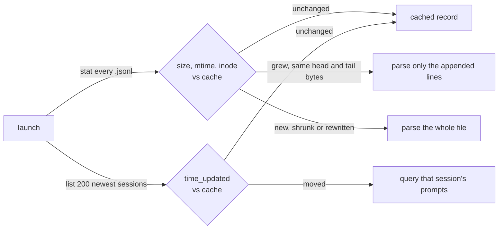

# Configuration and internals

Everything `agb` reads, where it keeps its own state, and the settings that
change how it launches a session.

## Accounts

Claude Code and Codex each keep credentials, config and session history under a
single home directory, which makes a second account nothing more than a second
home. Use each tool's normal home for the first account and an isolated one for
every account after that:

```bash
cc1() { command claude "$@"; }
cc2() { CLAUDE_CONFIG_DIR="$HOME/.claude-cc2" command claude "$@"; }

cx1() { command codex "$@"; }
cx2() { CODEX_HOME="$HOME/.codex-cx2" command codex "$@"; }
```

Authenticate each once (`cc2 auth login`, `cx2 login`), then tell `agb` about
them in `~/.config/agentbridge/config.json`:

```json
{
  "skipPermissions": false,
  "claudeAccounts": [
    { "name": "cc1" },
    { "name": "cc2", "configDir": "~/.claude-cc2" }
  ],
  "defaultClaudeAccount": "cc1",
  "codexAccounts": [
    { "name": "cx1" },
    { "name": "cx2", "codexHome": "~/.codex-cx2" }
  ],
  "defaultCodexAccount": "cx1"
}
```

Omit `configDir` or `codexHome` for the tool's normal default account. `agb` scans
each account's own store and remembers which account owns what, so a `cc1`
session resumes in `cc1` unless you deliberately retarget it.

Leave either block out and `agb` falls back to that tool's default home, labelling
it `[CC]` or `[CX]`.

Pick the starting target from the command line when that helps:

```bash
agb --target cx2            # any account name, or "oc" for OpenCode
agb --claude-account cc2    # the same thing, said the long way
agb --codex-account cx2
```

Full setup, verification and troubleshooting lives in
[Using multiple Claude Code accounts](multiple-claude-accounts.md) and
[Using multiple Codex accounts](multiple-codex-accounts.md).

### OpenCode wrappers

OpenCode wrappers with separate stores can appear as additional targets while
keeping the default `oc` target. For example:

```json
{
  "opencodeAccounts": [
    {
      "name": "opencode-i2cat",
      "command": "opencode-i2cat",
      "dbPath": "~/.local/share/opencode-i2cat-v1/opencode/opencode.db",
      "configHome": "~/.config/opencode-i2cat-v1"
    }
  ]
}
```

`command` names an executable or wrapper on your PATH (or an absolute path);
the wrapper sets its own environment. `dbPath` identifies its session store.
`configHome` optionally sets the XDG configuration root used by setup plans.
Run `agb --target opencode-i2cat` or choose it with `Ctrl+T`; `agb new --target
opencode-i2cat` starts a blank conversation. Switching between isolated stores
creates a transcript-seeded fork, while resuming within a store uses its wrapper
and original session ID. Each store gets its own session cache.

## Permissions

Launch the target tool with permission checks bypassed
(`claude --dangerously-skip-permissions` / `opencode --auto` /
`codex --dangerously-bypass-approvals-and-sandbox`):

```bash
agb --dangerous     # also --skip-permissions / --yolo
agb --safe          # force checks back on, overriding the config default
```

To go yolo just once, press `Ctrl+Y` in the picker. The status line turns into a
red `YOLO` for the launch you are about to make; press it again to go back to
asking. Nothing is saved.

Defaults live in `~/.config/agentbridge/config.json`, globally or per agent:

```json
{
  "skipPermissions": false,
  "opencode": { "skipPermissions": true },
  "claudeAccounts": [
    { "name": "cc1" },
    { "name": "cc2", "configDir": "~/.claude-cc2", "skipPermissions": true }
  ],
  "codexAccounts": [{ "name": "cx1", "skipPermissions": true }]
}
```

What wins, strongest first:

```
Ctrl+Y in the picker  →  --yolo / --safe  →  the target's skipPermissions  →  global skipPermissions
```

The setting follows the *target*, not the session: forking a `cc1` session into
`cx1` uses `cx1`'s default.

> **Note**
> Skipping permission checks lets the agent act on your filesystem without
> prompting. Turn it on only for directories where you accept that.

## Subscription suggestions

The header suggests the configured subscription with the most headroom.
AgentBridge compares the least remaining capacity across each account's rolling
windows, ignores blocked and unknown accounts, and keeps configuration order as
the tie-breaker. This is advice only: `Enter` still resumes a session in its own
account unless you pin another target. `Ctrl+G` pins the suggestion.

Claude Code limits come from the account's OAuth usage endpoint; Codex limits
come through its local app-server protocol. Each configured account is checked
with its own `CLAUDE_CONFIG_DIR` or `CODEX_HOME`. OpenCode is provider-agnostic,
so it remains `unknown` until it has a provider-neutral usage interface.
These are CLI-owned interfaces rather than a shared industry API; an older or
changed client degrades to `unknown` or the last cached observation.

Checks run after the picker's first frame and never delay opening it. A
two-minute snapshot lives in `~/.cache/agentbridge/limits.json` with mode `0600`.
It contains target names, percentages and reset times only, never access or
refresh tokens. If a refresh fails, the previous observation remains available
with its original timestamp. `agb limits --json` exposes the same
provider-neutral report so external tools do not need to read AgentBridge's
configuration or know provider APIs.

## Dry run

Set `AGB_DRY_RUN=1` and `agb` prints what it *would* launch (the command, the
account, the working directory) instead of launching it. Handy for checking how
a route resolves, and for bug reports:

```console
$ AGB_DRY_RUN=1 agb
would run CODEX_HOME=~/.codex-cx1 codex <transcript seed, 1655 chars>
  in ~/code/nebula-api
```

## Where the data comes from

`agb` reads each tool's existing store and never writes to them.

| Source | Path | Override |
| --- | --- | --- |
| OpenCode | `~/.local/share/opencode/opencode.db` (SQLite) | `OPENCODE_DB_PATH` |
| Claude Code | `~/.claude/projects/**/*.jsonl`, plus each account's `configDir` | `CLAUDE_PROJECTS_PATH` |
| Codex | `~/.codex/sessions/**/rollout-*.jsonl`, plus each account's `codexHome` | `CODEX_HOME`, `CODEX_SESSIONS_PATH` |
| `agb` config | `~/.config/agentbridge/config.json` | `AGB_CONFIG_PATH` |
| `agb` cache | `~/.cache/agentbridge/index.gob` | `AGB_CACHE_PATH`, `XDG_CACHE_HOME` |
| Picker layout | `~/.cache/agentbridge/layout.json`, beside the cache | follows the cache |
| Subscription limits | `~/.cache/agentbridge/limits.json`, beside the cache | follows the cache |
| Fork handoffs | `~/.cache/agentbridge/handoffs/`, beside the cache | follows the cache |

`agb` skips a store that's missing or unreadable instead of dying on it, so not
having OpenCode installed still gets you your Claude and Codex sessions.

Codex files each session as a rollout under `sessions/YYYY/MM/DD/` and archives
one by moving it into `archived_sessions/`, so archived Codex sessions drop out
of the list the way archived OpenCode ones do. Codex stores no title in the
rollout, which is why a Codex row is titled by its opening prompt.

## Why it starts fast

Reading every transcript on every launch is what used to make `agb` slow: on a
machine with a few hundred sessions that is hundreds of megabytes of JSONL. Now
`agb` keeps a cache of what each transcript boiled down to and only reads what
changed since the last launch:



Claude Code and Codex only ever append to a transcript, so the session you are
in the middle of, usually the biggest and the only one that changed, costs just
its new lines. The first launch builds the cache and takes as long as a full
read; after that the picker is up in a few tens of milliseconds. The cache is
safe to delete, and `agb --rescan` rebuilds it.
