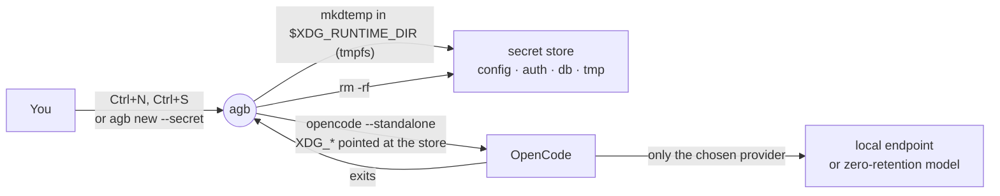

# Secret conversations

A secret conversation is an OpenCode session that leaves nothing behind. Its
whole store lives in a fresh directory in RAM and is deleted when OpenCode
exits. It also only runs on a model whose provider keeps nothing either:
keeping nothing locally means little if the provider holds on to the
conversation for 30 days.



Only OpenCode is supported. Claude Code and Codex keep a transcript of their own
and their providers' retention is set per account, not per session.

## Starting one

In the picker, press `Ctrl+N` and then `Ctrl+S`. The dialog turns into **New
secret conversation**: the directory is cleared, and the account list is
replaced by the models a secret conversation may use. `Tab`, `←`/`→` or a click
choose the model; `Ctrl+S` again turns it off and puts the directory back.

Leave the directory blank to start in a scratch directory inside the store: no
project, no `AGENTS.md`, nothing that ties the conversation to a repository. Or
type a project as usual.

From a shell:

```bash
agb new --secret                                    # the dialog, with Ctrl+S on
agb new --secret --model opencode-go/glm-5.3        # straight in, scratch directory
agb new --secret --model ollama/gpt-oss:20b --dir ~/src/app
```

`AGB_DRY_RUN=1` prints what would run without creating anything.

## Which models qualify

| Tier | Meaning | How agb knows |
| --- | --- | --- |
| `LOCAL` | The endpoint is this machine or a private network | A provider in your `opencode.json` whose `baseURL` is `localhost` or a loopback, private or link-local address. A hostname that resolves to one does not count. |
| `ZDR` | The provider documents zero data retention and no training | OpenCode Go's [privacy table](https://opencode.ai/docs/go/#privacy), copied into agb with its date, for the models in OpenCode's catalog. Only when you are signed in to OpenCode Go. |
| `KEEPS` | The provider keeps requests or trains on them | The same table |
| `?` | No known policy | Everything else, including your own providers on remote hosts |

Only `LOCAL` and `ZDR` can be picked. The rest are listed under **Not offered**
with the reason, so you can see why a model is missing. `agb new --secret
--model` refuses them too.

The OpenCode Go table has no API, so agb carries a snapshot. A model added to
Go after that date is `?` until agb is updated. Some agreements run for a fixed
period (DeepSeek's is renewed monthly): agb shows the end date and treats the
model as `?` once it has passed.

### Vouching for a model yourself

`secret` in `~/.config/agentbridge/config.json` overrides agb's decision, per
model or per provider, and sets the model the dialog starts on:

```json
{
  "secret": {
    "default": "opencode-go/glm-5.3",
    "models": {
      "homelab/*": "local",
      "corp/llama-4": "zdr",
      "opencode-go/kimi-k3": "retained"
    }
  }
}
```

The values are `local`, `zdr`, `retained` and `unknown`. A model named here that
agb would not otherwise list is offered too: the entry is you vouching for it.

## What the store contains

| | In a secret conversation |
| --- | --- |
| Session database, logs, state, cache, temporary files | In the store, deleted on exit |
| Your OpenCode config | Only `agent`, `command`, `permission`, `instructions`, `theme`, `keybinds`, `formatter`, `lsp`, `tools`, `username`, `compaction`, plus the chosen provider's entry |
| `AGENTS.md`, agents, commands, skills, themes, `tui.json(c)` | Linked from your config directory, read only |
| Plugins and MCP servers | None. Plugins can write memory files, send activity to a service or show message text in notifications, and remote MCPs see what the agent sends them. |
| Credentials | Only the chosen provider's API key, read from OpenCode's database (or `auth.json`) and passed in `AGB_SECRET_API_KEY`, never written to the store. Providers you sign in to with OAuth are not supported. |
| A project's own `opencode.json` or `.opencode/` | Ignored (`OPENCODE_DISABLE_PROJECT_CONFIG`) |
| Sharing, auto-update, model catalog fetch | Off; the catalog is read from your existing cache |

OpenCode runs with `--standalone`, a private server, because the background
service writes to your usual database.

The config allowlist is deliberate: a setting OpenCode adds later is left out
until it is known to be safe. If your agents need something that is not on the
list, open an issue.

## Limits

- **The store is in RAM where there is one.** On Linux that is
  `$XDG_RUNTIME_DIR`, a tmpfs. Without it (macOS, some containers) the store
  goes in the temporary directory, on disk until OpenCode exits, and agb says
  so when it starts.
- **A killed agb cannot clean up.** After `kill -9` or a crash the store stays
  until the next secret conversation, which deletes stores whose agb is gone, or
  until a reboot clears the tmpfs.
- **OpenCode still reads `~/.claude` and `~/.agents`.** OpenCode 2 treats them
  as configuration directories, so their skills and `CLAUDE.md` are read. Nothing
  is written there.
- **What the agent does in a project stays.** Files it edits and commands it
  runs in a real directory are real. Use the scratch directory when the
  conversation should leave no trace at all.
- **Secret conversations never appear in agb.** The store is in no list, so
  there is nothing to resume, fork, push or pull. That is the point.
